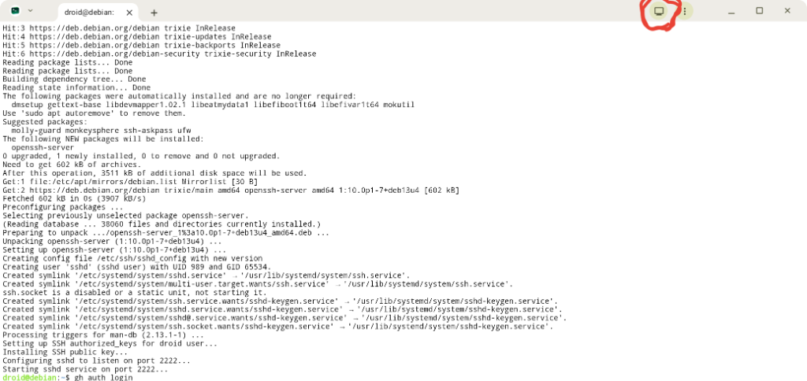
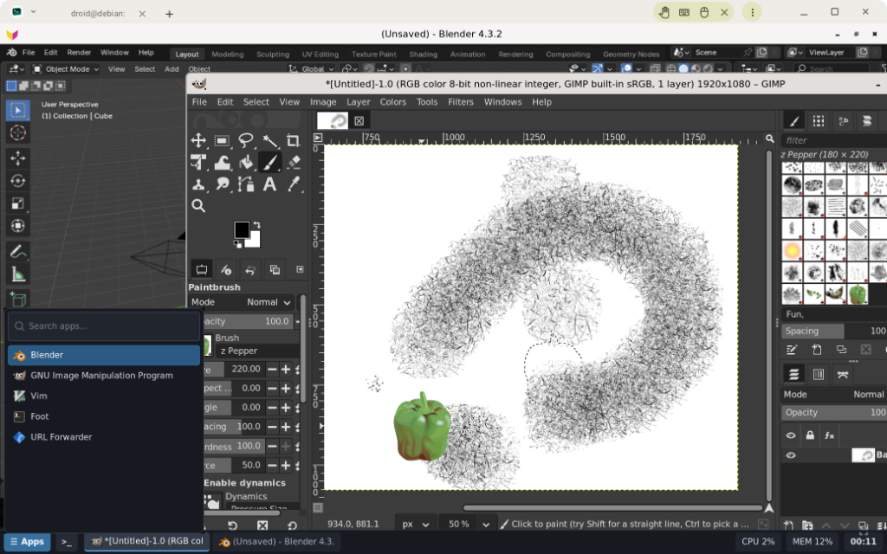

# Basic Launcher for Linux Terminal Desktop Mode

A quick guide to upgrading the Android **Linux Terminal** VM's Desktop Mode from the stock Weston compositor to a minimal **labwc + Waybar + Wofi/Fuzzel + Foot** desktop with an **Apps** launcher, window taskbar, Xwayland support, and automatic DPI/GPU detection using [`setup-labwc.sh`](setup-labwc.sh).

---

## What `setup-labwc.sh` Does

- Replaces the default Weston session (`weston.service` / `weston.socket` via user systemd overrides in `~/.config/systemd/user`) so your setup persists across VM updates.
- Installs a lightweight Wayland desktop: **labwc** (window manager), **Waybar** (bottom panel with an **Apps** menu, terminal shortcut, taskbar, and CPU/RAM/clock), **Wofi / Fuzzel** (searchable app launcher), **Foot** (terminal), and **Xwayland** (so both Wayland and X11 apps like Blender and GIMP run smoothly).
- Automatically detects `Virtio-GPU Venus`, `Gfxstream`, or software rendering (`Lavapipe`) and scales display DPI dynamically.

---

## Step 1: Move `setup-labwc.sh` to a Terminal-Accessible Location

1. Download or locate `setup-labwc.sh` on your device (for example, in **Downloads**).
2. Open the Android **Files** app.
3. Copy or move `setup-labwc.sh` into the **Linux VM** folder in **Files** (which maps directly to your home directory `~/` inside the Terminal VM).
   - *Alternative:* If you keep it in Android **Documents** (`/storage/emulated/10/Documents/setup-labwc.sh`), you can access it in Terminal at `/mnt/shared/Documents/setup-labwc.sh` or copy it to `~/` with:
     ```bash
     cp /mnt/shared/Documents/setup-labwc.sh ~/
     ```

---

## Step 2: Give Execute Permissions in Terminal

Open the **Terminal** app, make sure you are in your home directory (`cd ~`), and mark the script executable:

```bash
cd ~
chmod +x setup-labwc.sh
```

---

## Step 3: Run the Setup Script

Execute the script inside the Terminal:

```bash
./setup-labwc.sh
```

Wait for `apt` to install the required packages and configure the user systemd services.

> *(Optional)* If you ever want to revert back to the stock Weston desktop later, run:
> ```bash
> ./setup-labwc.sh --restore-weston
> ```

---

## Step 4: Restart the Terminal App

Close and reopen the **Terminal** app (or stop/restart the Linux VM from Terminal's settings) so the new `labwc` user systemd session starts in place of Weston.

---

## Step 5: Open Desktop Mode

1. After the Terminal restarts, look at the **top-right toolbar** of the Terminal app.
2. Click the **Desktop Mode** icon (the display/monitor icon circled in red below) to switch from the console view into the Linux graphical desktop:



---

## Result: Basic Launcher in Desktop Mode

Once Desktop Mode opens, you'll see the **Waybar** panel along the bottom with the **Apps** button on the left (and a quick terminal `>_` button next to it), running windows in the center, and CPU / memory / clock indicators on the right.

Clicking **Apps** opens the searchable launcher where you can launch installed GUI apps (such as Blender, GIMP, Vim, Foot, etc.):


