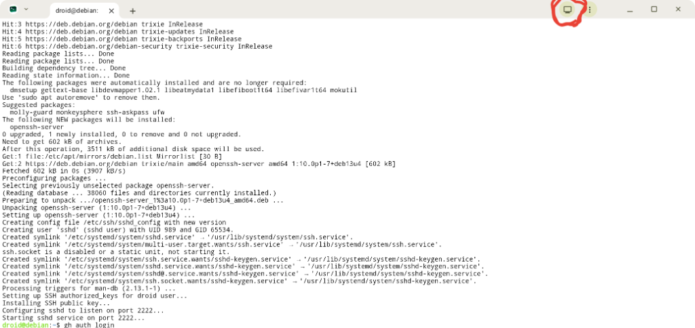
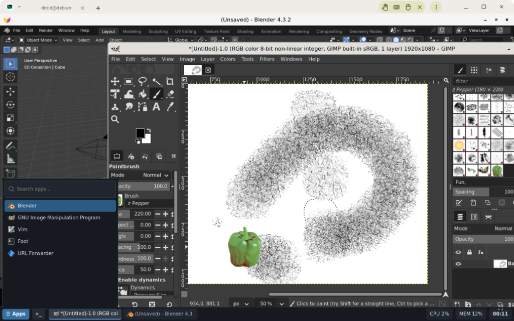

# Googlebook Linux Terminal Tools

Various tips, guides, and scripts I am using to make the most out of the **Googlebook Linux Terminal** environment.

> [!WARNING]
> **Experimental / Advanced Users Only:** These are advanced user tools and experimental setups—recommended for **advanced users only**. **Backing up your data on the Linux side is strongly recommended** before making system changes, modifying compositor services, or running heavy GPU workloads.

> [!TIP]
> **Recommended VM Memory:** In the Android **Terminal** app settings, increase the Linux VM memory to **8 GB** (on 16 GB systems) or **12 GB+** (on 32 GB systems) if you plan to run games, local LLMs, or memory-heavy Linux applications.

---

## Included Guides & Tools

### 1. [Running `llama.cpp` and OpenCode on Googlebooks](Running%20llama.cpp%20and%20opencode%20on%20Googlebooks.md)
- Prebuilt Linux binary installation for **`llama.cpp`** (Vulkan GPU + CPU) and **OpenCode** on both **`x86_64`** and **`aarch64` (ARM64)** Googlebooks.
- Terminal VM tuning (enabling GPU-accelerated rendering and increasing VM memory to 8 GB+).
- Verifying and benchmarking Vulkan (`Virtio-GPU Venus`) vs. CPU inference.
- Connecting OpenCode to a local `llama-server` for offline coding, either directly in Terminal or through Antigravity.

### 2. [Basic Launcher for Linux Terminal Desktop Mode](Basic%20Launcher%20for%20Linux%20Terminal%20Desktop%20Mode.md) ([`setup-labwc.sh`](setup-labwc.sh))
- Upgrades Terminal **Desktop Mode** from the stock Weston setup to a minimal **`labwc` + `Waybar` + `Wofi`/`Fuzzel` + `Foot`** desktop with an **Apps** menu, window taskbar, CPU/RAM/clock indicators, and persistent Xwayland support.
- Includes `--restore-weston` to revert back to the stock setup at any time.

#### Screenshots

**Switching to Desktop Mode from the Terminal toolbar:**

**Basic Launcher in Desktop Mode (`labwc` + `Waybar` + `Wofi`):**

